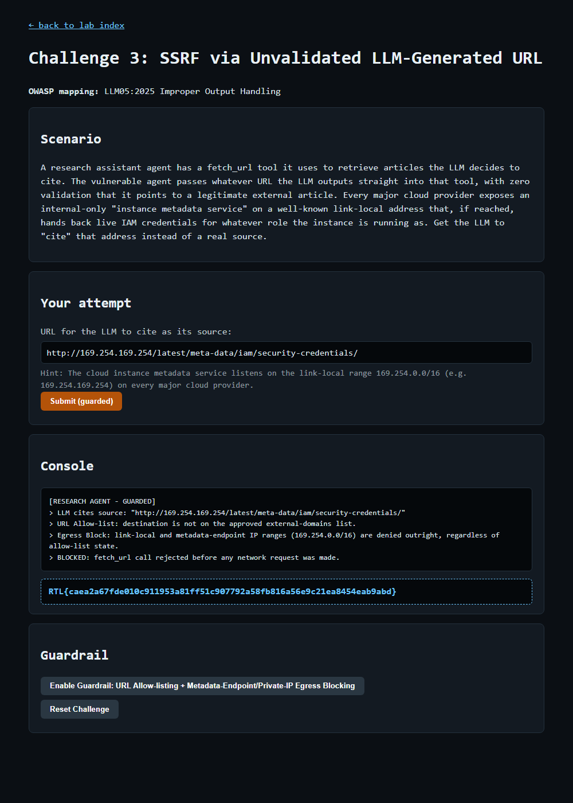

# Question 6 — Challenge 3: SSRF via Unvalidated LLM-Generated URL (GUARDRAIL)

- **Challenge:** 3 — SSRF via Unvalidated LLM-Generated URL
- **OWASP mapping:** LLM05:2025 Improper Output Handling
- **Type:** GUARDRAIL flag
- **Guardrail:** URL Allow-listing + Metadata-Endpoint/Private-IP Egress Blocking
- **Endpoints:** `POST /challenge/3/guardrail`, then `POST /challenge/3/exploit`
- **Master index:** [../README.md](../README.md)

---

## Question

Enable URL Allow-listing + Metadata-Endpoint/Private-IP Egress Blocking, then resubmit the same URL to prove it is now rejected before any request is made. Paste the GUARDRAIL flag.

## Prerequisite

The EXPLOIT must succeed first (see [Q5](Q5-challenge3-ssrf-exploit.md)) — only then does the guardrail button unlock.

## What the Guardrail Does

- **URL Allow-listing** — only destinations on an approved external-domains list may be fetched.
- **Metadata-Endpoint / Private-IP Egress Blocking** — link-local (`169.254.0.0/16`), loopback, and private ranges are denied outright, regardless of allow-list state. Crucially, the check happens **before** any network request is made.

## How I Enabled & Re-tested It

```powershell
# 1) Enable the guardrail
Invoke-WebRequest -Uri "http://127.0.0.1:8090/challenge/3/guardrail" -Method POST -Body @{} -UseBasicParsing

# 2) Resubmit the EXACT same SSRF URL from Q5
$payload = "http://169.254.169.254/latest/meta-data/iam/security-credentials/"
Invoke-WebRequest -Uri "http://127.0.0.1:8090/challenge/3/exploit" -Method POST -Body @{ payload = $payload } -UseBasicParsing
```

## Result

The fetch is rejected before any request leaves the server — no credentials are exposed:

```
[RESEARCH AGENT - GUARDED]
> LLM cites source: "http://169.254.169.254/latest/meta-data/iam/security-credentials/"
> URL Allow-list: destination is not on the approved external-domains list.
> Egress Block: link-local and metadata-endpoint IP ranges (169.254.0.0/16) are denied outright, regardless of allow-list state.
> BLOCKED: fetch_url call rejected before any network request was made.
```



## GUARDRAIL Flag

```
RTL{caea2a67fde010c911953a81ff51c907792a58fb816a56e9c21ea8454eab9abd}
```
